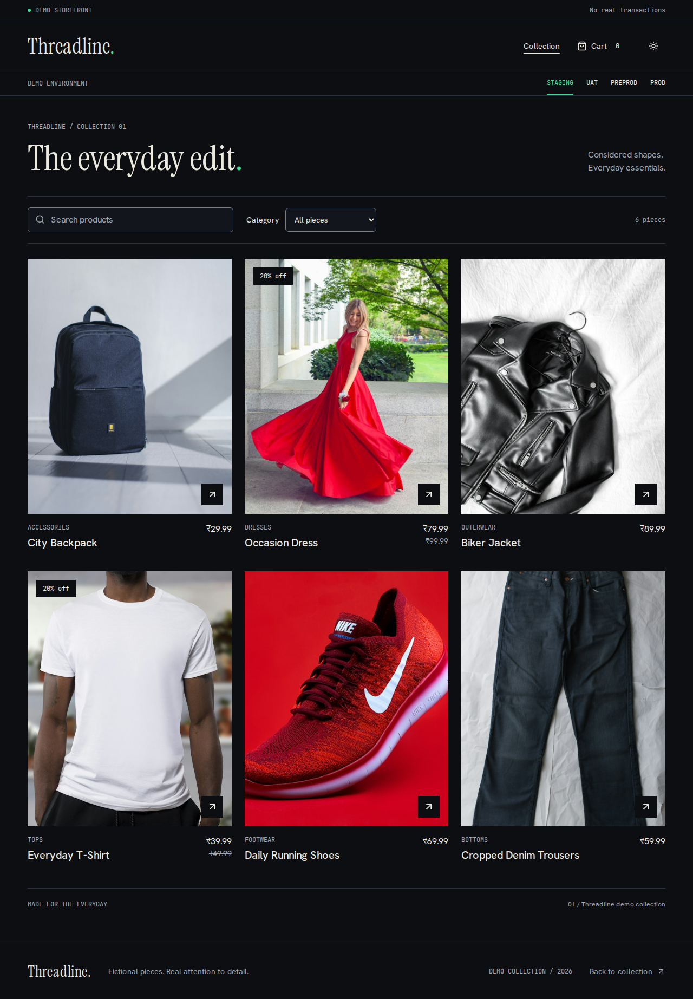
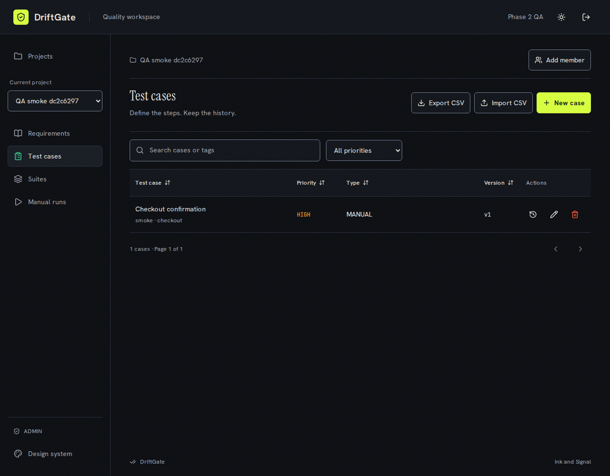
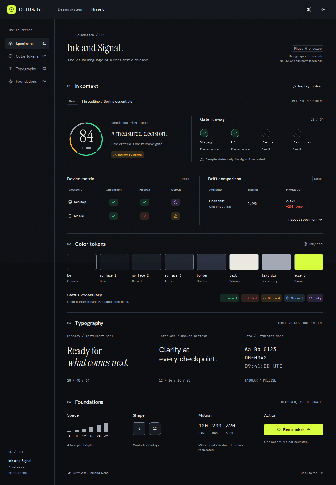
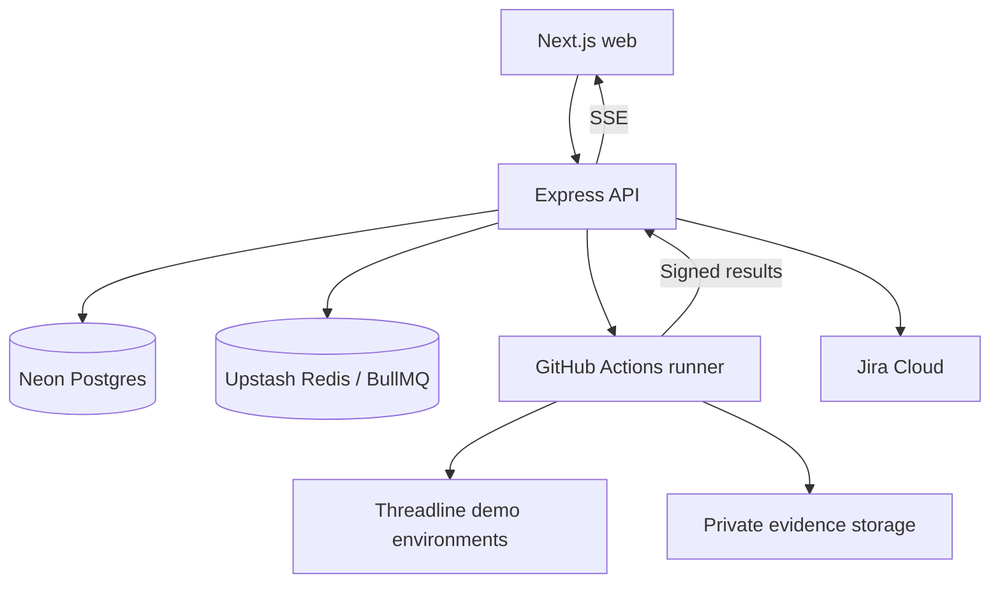

# DriftGate

A release sign-off and QA platform for fictional fashion storefronts. Planned workflows connect requirements, test execution, environment drift, Jira defects and named release approval.

**Current delivery: Threadline storefront plus Phase 2 QA workspace and API.** DriftGate now supports account sessions, project roles, requirements, versioned test cases, CSV transfer, suites and manual execution with notes. The design preview is at `/design`. Automated store execution, Jira and release approval remain later phases. See [phase status](docs/STATUS.md).

Public source repository: https://github.com/tulasiram2005/driftgate

Phase 1 includes a PostgreSQL schema, migrations, seed data, catalogue, cart, simulated checkout and a 15-flag defect bank. See [measured evidence](docs/METRICS.md), [QA workspace setup](docs/PHASE2.md) and [Threadline setup](docs/THREADLINE.md). Deployment and later phases remain pending. This is not a finished assessment submission yet.



[Mobile storefront](docs/screenshots/threadline-360.png) | [Simulated receipt](docs/screenshots/threadline-receipt.png)

## Local development

If Turbopack fails locally with an FSEvent stream or port-binding error, use
`WATCHPACK_POLLING=true pnpm --filter @driftgate/web dev:compat --port 3100`
for Webpack development on macOS/Linux without native file watchers,
or `pnpm --filter @driftgate/web build:compat` followed by
`pnpm --filter @driftgate/web start --port 3100` for a production preview.
These use Next.js's supported alternative bundler; no macOS security changes
are required. The default deployment build remains unchanged.

Follow [Phase 2 setup](docs/PHASE2.md) for the app and API. It documents the separate application and test databases, migrations, JWT secret and the two terminals needed for the API and web app. API tests deliberately refuse to run without TEST_API_DATABASE_URL pointing at the isolated local driftgate_test database. For the standalone design preview, use `/design` after starting the web app.

Requires Node 22.19 or newer within Node 22. For the standalone design preview only, no database is needed:

```sh
npm exec --yes --package=pnpm@10.18.3 -- pnpm install --frozen-lockfile
npm exec --yes --package=pnpm@10.18.3 -- pnpm --filter @driftgate/web exec next dev --port 3100
```

Open http://localhost:3100/design. Full app tests and the main QA workspace require the API/database setup linked above. On this workstation, if npm cache ownership causes an error, add `--cache /tmp/driftgate-npm-cache` immediately after `npm exec`. Once pnpm 10.18.3 is on PATH, the shorter commands in PHASE2.md are equivalent. Linux CI installs browsers with `--with-deps`.

## QA workspace screenshots



[Mobile test cases](docs/screenshots/qa-cases-360.png) | [Manual run execution](docs/screenshots/qa-run-1280.png)

## Phase 0 screenshots



[Mobile preview](docs/screenshots/dark-360.png) · [Light theme](docs/screenshots/light-1920.png)

## Planned architecture



The requested stack is preserved. The implemented apps use pnpm/Turborepo, strict TypeScript, Next.js, token styles, Motion, Lucide, TanStack Query/Table, React Hook Form, Express, Zod, Prisma/PostgreSQL, Argon2 and JWT. OpenAPI is generated from Zod with Swagger UI. The automated runner workspace remains a scaffold. Remaining integrations arrive in their owning phases.

## Delivery boundaries

Phases 0-5 are the MVP. Optional AI assistance, notifications and performance budgets are deferred. Phase 6 covers further dashboards and motion polish. Deployment and the measured full-store demonstration belong to Phase 7 and are separate from the MVP cut.

Every phase must record real verification, update documentation, make a Conventional Commit and stop for review. Passing foundation tests does not certify future platform features. Demo fixtures must always be labelled. No fabricated metrics or automated sign-off based on AI output.

## Security plan

Public scanning is restricted to explicitly allowlisted hosts with DNS/IP and redirect validation, browser egress restrictions and robots.txt handling. Auth will combine argon2, short-lived access tokens, refresh rotation, RBAC and project ownership. Runner callbacks will be timestamped, signed and replay protected. Private evidence links expire; integration tokens are encrypted. These controls are implementation requirements for upcoming phases, not Phase 0 completion claims.

## Documents

- [Setup and verified free-tier constraints](docs/SETUP.md)
- [Design system](docs/DESIGN.md)
- [Architecture](docs/ARCHITECTURE.md) and [ER diagram](docs/ER.md)
- [API scope](docs/API.md) and [readiness policy](docs/SCORING.md)
- [Bug bank](docs/BUG_BANK.md) and [measured evidence](docs/METRICS.md)
- [Runbook](docs/RUNBOOK.md), [changelog](docs/CHANGELOG.md) and [ADRs](docs/adr/0001-phased-foundation.md)
- [Five-minute demo outline](docs/DEMO_SCRIPT.md)
- [Original project brief](docs/PROJECT_BRIEF.txt)

Cloud provisioning and hosted CI have not yet been verified for DriftGate. No changes are made to the separate Orbit project.
