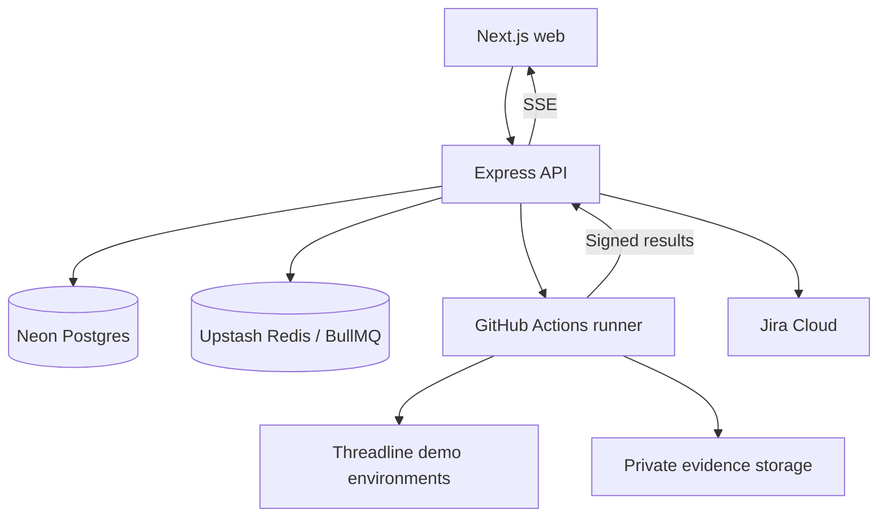

# DriftGate

A release sign-off and QA platform for fictional fashion storefronts. Planned workflows connect requirements, test execution, environment drift, Jira defects and named release approval.

**Current delivery: Phase 0 foundation.** The runnable web surface is the Ink and Signal design preview. It does not execute tests against stores, authenticate users, connect Jira or approve real releases yet. See [phase status](docs/STATUS.md).

## Local preview

Requires Node 22.19 or newer within Node 22. No cloud accounts, environment variables or database are needed for Phase 0. Run from this repository:

```sh
npm exec --yes --package=pnpm@10.18.3 -- pnpm install --frozen-lockfile
npm exec --yes --package=pnpm@10.18.3 -- pnpm typecheck
npm exec --yes --package=pnpm@10.18.3 -- pnpm lint
npm exec --yes --package=pnpm@10.18.3 -- pnpm test
npm exec --yes --package=pnpm@10.18.3 -- pnpm build
npm exec --yes --package=pnpm@10.18.3 -- pnpm --filter @driftgate/web exec playwright install chromium firefox webkit
npm exec --yes --package=pnpm@10.18.3 -- pnpm test:e2e
npm exec --yes --package=pnpm@10.18.3 -- pnpm dev
```

Open the local address printed by Next.js. On this workstation, if npm cache ownership causes an error, add `--cache /tmp/driftgate-npm-cache` immediately after `npm exec`. Once a working pnpm 10.18.3 is on PATH, the shorter `pnpm` commands in AGENTS.md are equivalent. Linux CI installs browsers with `--with-deps`.

## Phase 0 screenshots


[Mobile preview](docs/screenshots/dark-360.png) · [Light theme](docs/screenshots/light-1920.png)

## Planned architecture



The exact requested stack is preserved. Phase 0 uses pnpm/Turborepo, strict TypeScript, Next.js, token-based Tailwind styles, Motion, Lucide, Vitest and Playwright. Express API and runner workspaces are scaffolds for subsequent phases. Remaining stack components are introduced with their owning features, not represented as already integrated.

## Delivery boundaries

Phases 0-5 are the MVP. Optional AI assistance, notifications and performance budgets are deferred. Phase 6 covers further dashboards and motion polish. Deployment and the measured full-store demonstration belong to Phase 7 and are separate from the MVP cut.

Every phase must record real verification, update documentation, make a Conventional Commit and stop for review. Passing foundation tests does not certify future platform features. Demo fixtures must always be labelled. No fabricated metrics or automated sign-off based on AI output.

## Security plan

Public scanning is restricted to explicitly allowlisted hosts with DNS/IP and redirect validation, browser egress restrictions and robots.txt handling. Auth will combine argon2, short-lived access tokens, refresh rotation, RBAC and project ownership. Runner callbacks will be timestamped, signed and replay protected. Private evidence links expire; integration tokens are encrypted. These controls are implementation requirements for upcoming phases, not Phase 0 completion claims.

## Documents

- [Setup and verified free-tier constraints](docs/SETUP.md)
- [Design system](docs/DESIGN.md)
- [Architecture](docs/ARCHITECTURE.md) and [ER diagram](docs/ER.md)
- [API scope](docs/API.md) and [readiness policy](docs/SCORING.md)
- [Bug bank](docs/BUG_BANK.md) and [measured evidence](docs/METRICS.md)
- [Runbook](docs/RUNBOOK.md), [changelog](docs/CHANGELOG.md) and [ADRs](docs/adr/0001-phased-foundation.md)
- [Five-minute demo outline](docs/DEMO_SCRIPT.md)
- [Original project brief](docs/PROJECT_BRIEF.txt)

Public GitHub publishing, cloud provisioning and hosted CI have not yet been verified for DriftGate. No changes are made to the separate Orbit project.
