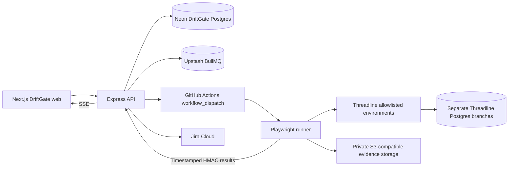

# Architecture

Status: target architecture. Phase 0 is the foundation and token preview, not a functioning release platform.

## Boundaries

The DriftGate and Threadline databases never share application credentials. Every project-scoped API request requires both role and membership/ownership checks. Run results reference the immutable test-case version used at execution time.

Browser automation runs in GitHub Actions or an isolated local runner, not in a Vercel request or a sleeping Render process. Phase 3 must implement a recoverable dispatch/outbox design and measure Redis polling costs. Server-Sent Events require reconnect and resumable event IDs; deployment sleep is not treated as completion.

Evidence is private by default and exposed using short-lived authorized URLs. Integration credentials are encrypted server-side. Callback signatures cover timestamp, run identity and raw payload; replay rejection is persisted.

## Scanning constraints

Public scanning must validate every DNS result, redirects, protocol and target against the project allowlist. Browser subresources also need egress control; validating only the initial URL is insufficient. This protection is planned, not implemented by the Phase 0 scaffold.

Local development cannot silently bypass production SSRF restrictions. Phase 1/3 will use a fixed-target isolated demo harness with no user-selected private network destination. A malicious URL must never be able to reach local services or cloud metadata.

## MVP boundary

Phases 0-5 implement the core platform. Optional AI, notifications and performance budgets are deferred. Phase 6 adds dashboard/motion polish; Phase 7 deploys and measures the end-to-end demo. Basic accessibility, error handling and honest verification are required in every phase, not postponed to Phase 6.
