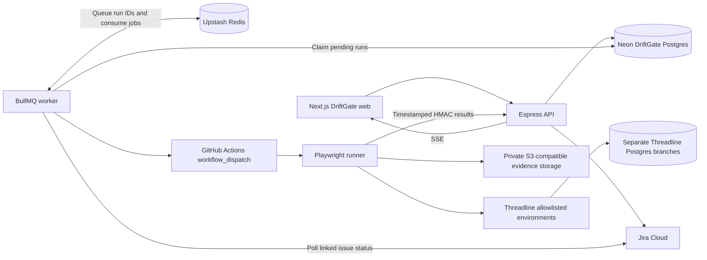

# Architecture

DriftGate connects test requirements and execution evidence to release decisions. Threadline, a separate demo storefront with 15 switchable defects, provides repeatable comparison targets. Phase 5 closed for the MVP. See [project status](STATUS.md) for dated checks and hosted availability.

## Boundaries

The DriftGate and Threadline databases never share application credentials. Every project-scoped API request requires membership plus the relevant role. ADMIN manages membership; ADMIN and QA create cases, suites and manual runs; DEVELOPER and APPROVER have read access in Phase 2. Roles are project-scoped, not supplied by registration. A user outside a project receives 404 for its nested resources.

Access tokens live in client memory and expire after 15 minutes. Refresh credentials are opaque, hashed in the database, delivered in an HttpOnly SameSite=Strict cookie, rotated on refresh, and revoked on logout. Production cookies use Secure and the __Host- prefix. Origin checks protect cookie operations. A Next.js rewrite proxies /api/v1 to API_URL so the browser uses a same-origin API. Deployment must preserve that proxy.

## From a test case to a release

1. A project member records requirements, versioned test cases and ordered steps, then groups cases into suites. Manual runs retain the case version and steps the tester actually executed.
2. For an automated run, the API persists the requested work in PostgreSQL. A worker claims pending dispatch records, enqueues run IDs in Redis and reloads the job payload from the database. It dispatches to GitHub Actions or launches the configured local sandbox.
3. Playwright exercises the bundled storefront across browser and device combinations. A separate relay uploads evidence to private S3-compatible storage and sends signed results back to the API. The workspace displays run events over a resumable event stream with polling fallback.
4. Reviewers compare snapshots, apply expected-difference rules, review screenshot changes against approved baselines and inspect SQL check results. The project keeps review decisions and linked defects. Its Jira integration exports selected defects and synchronizes linked issue status.
5. Release readiness combines critical tests, open defects, drift, visual review and accessibility evidence. Approvers record named decisions against a revision of that evidence. The release report includes the decision and audit history.

## Implementation stack

| Component                      | Implementation                                                                                                                                    |
| ------------------------------ | ------------------------------------------------------------------------------------------------------------------------------------------------- |
| Workspace and demo storefront  | Next.js, React and TypeScript. The workspace uses Tailwind CSS, TanStack Query/Table, React Hook Form, Zod, Motion and Lucide.                    |
| API and persistence            | Node.js, Express, Prisma and PostgreSQL. Zod and OpenAPI describe requests. Argon2 and JOSE support authentication. Pino records structured logs. |
| Execution and evidence         | BullMQ, Redis, GitHub Actions, Docker, Playwright, axe-core, Pixelmatch, pngjs and the AWS S3 SDK.                                                |
| Reporting and external systems | PDFKit and Fontkit, Jira Cloud, Neon PostgreSQL, Supabase Storage and the Render API service. Vercel is the intended web host.                    |
| Development and checks         | pnpm workspaces, Turborepo, TypeScript, ESLint, Prettier, Vitest, Supertest and GitHub Actions CI.                                                |

Evidence is private by default and exposed using short-lived authorized URLs. Integration credentials are encrypted server-side. Callback signatures cover timestamp, run identity and raw payload; replay rejection is persisted.

## Runner targets

The runner accepts the fixed Threadline target and enumerated checks, environments and browser/device combinations. The [runner contract](../apps/runner/CONTRACT.md) defines the payload. Browser execution is isolated from the credentialed evidence relay. General-purpose URL scanning falls outside the implemented demo.

## MVP boundary

Phases 0-5 implement the core platform. Optional AI, notifications and performance budgets are deferred. Phase 6 adds dashboard/motion polish; Phase 7 deploys and measures the end-to-end demo. Basic accessibility, error handling and honest verification are required in every phase, not postponed to Phase 6.
