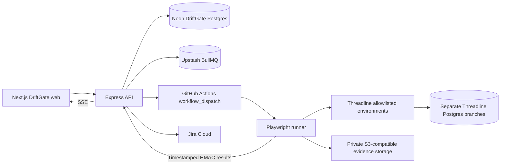

# Architecture

Status: Phase 1 storefront and Phase 2 QA workspace/API are implemented locally. Queue, automated execution, evidence storage, drift, Jira and release approval in the diagram remain later-phase targets.

## Boundaries

The DriftGate and Threadline databases never share application credentials. Every project-scoped API request requires membership plus the relevant role. ADMIN manages membership; ADMIN and QA create cases, suites and manual runs; DEVELOPER and APPROVER have read access in Phase 2. Roles are project-scoped, not supplied by registration. A user outside a project receives 404 for its nested resources.

Access tokens live in client memory and expire after 15 minutes. Refresh credentials are opaque, hashed in the database, delivered in an HttpOnly SameSite=Strict cookie, rotated on refresh, and revoked on logout. Production cookies use Secure and the __Host- prefix. Origin checks protect cookie operations. A Next.js rewrite proxies /api/v1 to API_URL so the browser uses a same-origin API. Deployment must preserve that proxy.

Run results snapshot the title, ordered steps and version used at execution time. Case edits append an immutable CaseVersion, while deletion archives the current case; earlier runs remain readable. Notes provide manual execution evidence in Phase 2. Screenshot upload/storage is Phase 3. Suites contain validated project-scoped case identifiers; database-level suite joins and standalone step normalization remain explicit follow-up data-model work before automated runner integration.

Browser automation runs in GitHub Actions or an isolated local runner, not in a Vercel request or a sleeping Render process. Phase 3 must implement a recoverable dispatch/outbox design and measure Redis polling costs. Server-Sent Events require reconnect and resumable event IDs; deployment sleep is not treated as completion.

Evidence is private by default and exposed using short-lived authorized URLs. Integration credentials are encrypted server-side. Callback signatures cover timestamp, run identity and raw payload; replay rejection is persisted.

## Scanning constraints

Public scanning must validate every DNS result, redirects, protocol and target against the project allowlist. Browser subresources also need egress control; validating only the initial URL is insufficient. This protection is planned; Phase 2 does not accept scan URLs or perform external scans.

Local development cannot silently bypass production SSRF restrictions. Phase 1/3 will use a fixed-target isolated demo harness with no user-selected private network destination. A malicious URL must never be able to reach local services or cloud metadata.

## MVP boundary

Phases 0-5 implement the core platform. Optional AI, notifications and performance budgets are deferred. Phase 6 adds dashboard/motion polish; Phase 7 deploys and measures the end-to-end demo. Basic accessibility, error handling and honest verification are required in every phase, not postponed to Phase 6.
