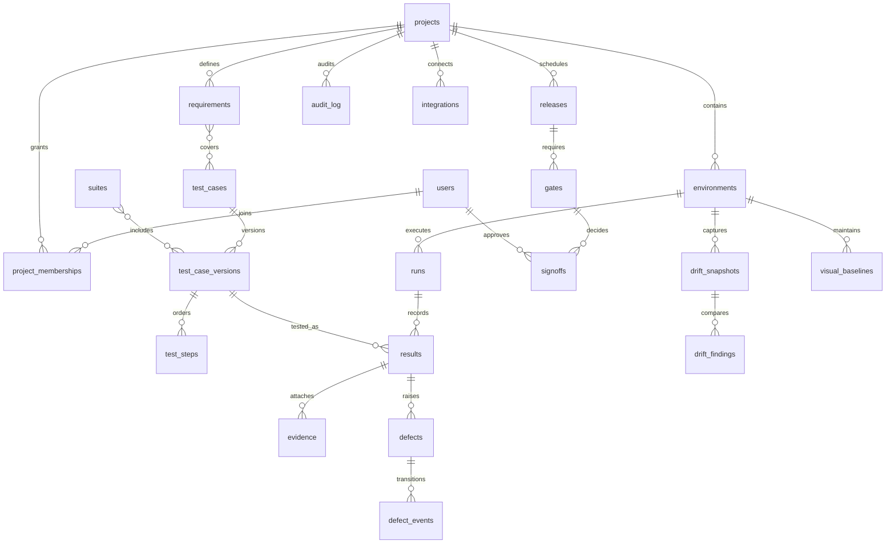

# Data model

Status: planned relationships. Prisma schema, indexes and migrations are due in Phase 2. This diagram is not evidence of a deployed database.

The implementation must resolve many-to-many edges with explicit join tables and index foreign keys and query cursors. Store currency as decimal or integer minor units, timestamps as UTC instants, and environment timezones as validated IANA names. Hash-chaining is tamper-evident, not a claim of tamper-proof storage.
