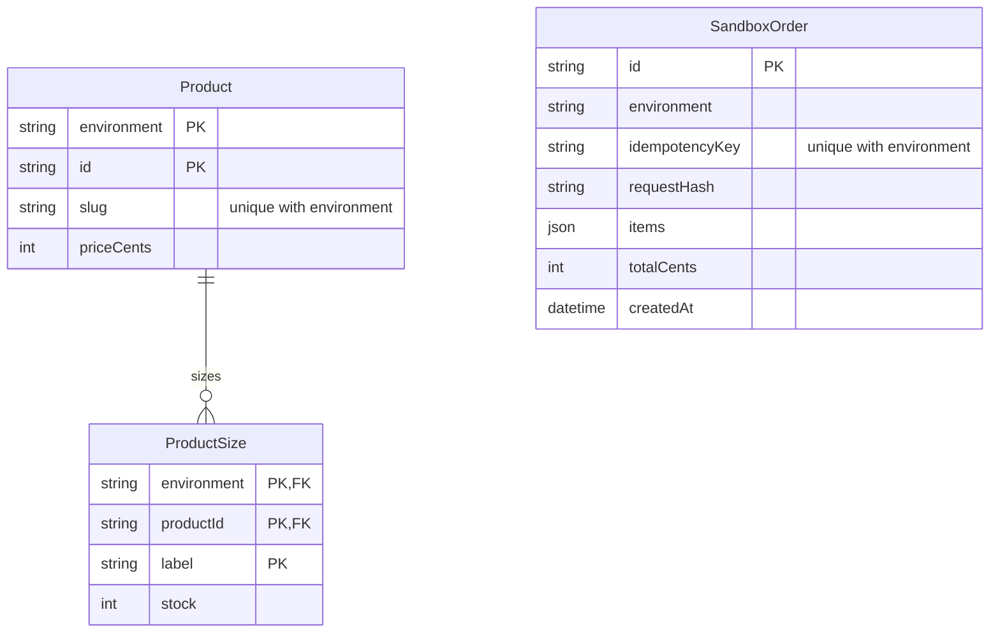
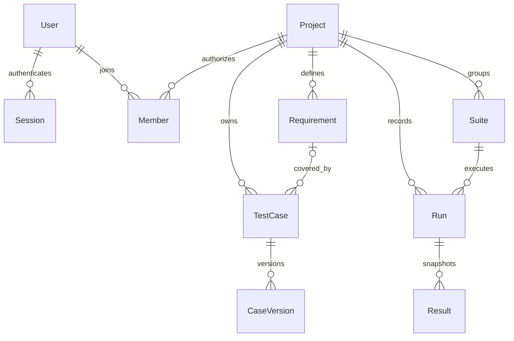
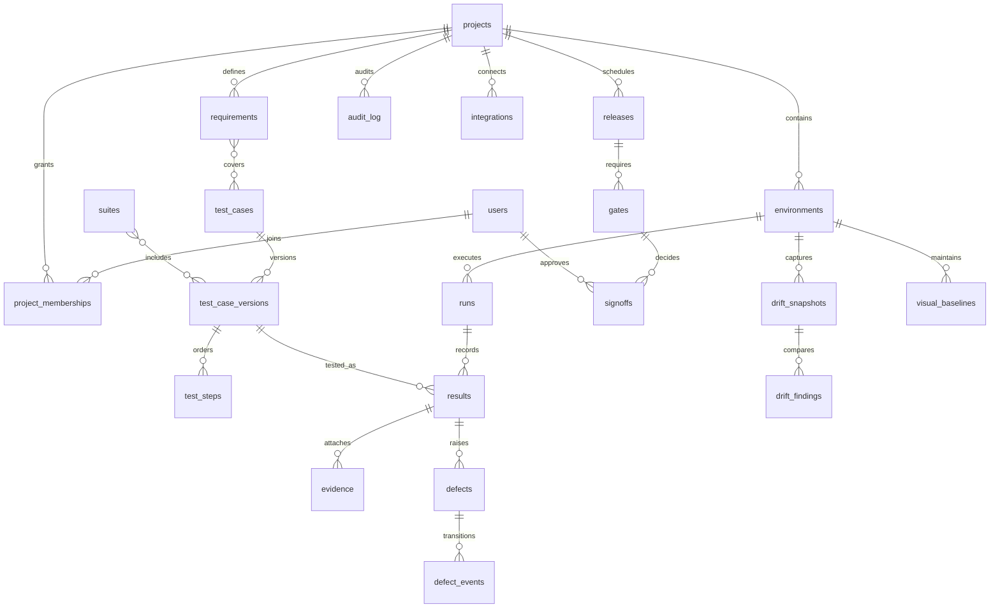

# Data model

## Implemented Threadline schema

The separate Threadline database has migration `202610190001_threadline` under `apps/demo-store/prisma/migrations`. Products and sizes are scoped by environment. Orders store an immutable JSON line-item snapshot, integer totals, request hash and a unique environment/idempotency-key pair. Seeding creates missing records without resetting stock or deleting orders.

## Implemented DriftGate Phase 2 schema

Migration `apps/api/prisma/migrations/202610190002_phase2` creates the separate QA database. Users have project-scoped Member roles and hashed refresh Sessions. Projects own Requirements, TestCases, Suites and Runs. TestCase changes append immutable CaseVersion snapshots. Results snapshot test title, steps and version so later edits/archives preserve run evidence. Steps are ordered JSON and suite case IDs are a validated array in this first implementation; database-level join/step normalization is tracked before the runner phase.

## Future relationships

The expanded model below includes later-phase evidence, defects, integrations and release approval. It is a target model, not evidence of deployed services.

The implementation must resolve many-to-many edges with explicit join tables and index foreign keys and query cursors. Store currency as decimal or integer minor units, timestamps as UTC instants, and environment timezones as validated IANA names. Hash-chaining is tamper-evident, not a claim of tamper-proof storage.
